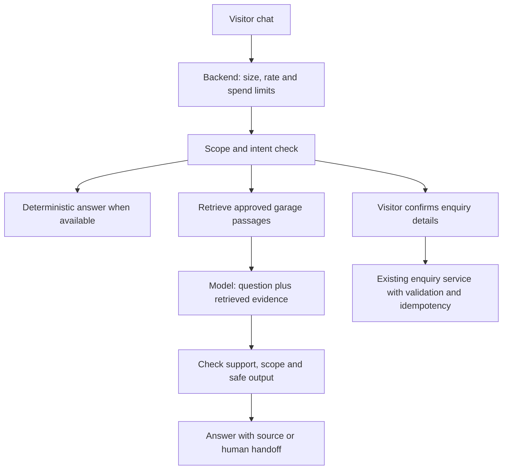
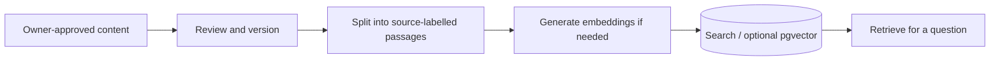

# Future chatbot and RAG roadmap

Proposed only. RAG means retrieval-augmented generation: retrieve approved garage information, then ask a model to answer using that evidence. It does not mean training a model on customer conversations. A deterministic FAQ may solve the initial need with less cost and risk.

## Intended scope

Answer opening hours, location, supported services and garage-approved general questions. Explain that estimates and appointments need confirmation. Help a visitor submit an enquiry through the existing service. Avoid invented prices, stock, availability, remote diagnoses or unsupported claims. Do not let an untrusted conversation access other customers' enquiries.

## Proposed runtime flow

The enquiry service remains authoritative. The model cannot submit arbitrary SQL or execute arbitrary tools. Any future tool uses typed, allow-listed arguments, server-side validation and explicit visitor confirmation before creating a record.

## Knowledge ingestion flow

Begin with curated FAQs and text search. Evaluate retrieval before adding vector storage; verify PostgreSQL extension support if choosing pgvector. Store source ID, document version, approval status and update time. Remove withdrawn content from the retrieval index. Customer messages are not trusted knowledge sources.

## Ordered acceptance criteria

1. Scope and baseline
   - [ ] Agree common questions, approved answers, handoff wording and provider budget.
   - [ ] Measure a FAQ-only baseline before selecting a model or retrieval approach.
2. Retrieval
   - [ ] Ingest only approved content with source/version metadata.
   - [ ] Build an evaluation set covering real questions, missing information and conflicting/stale information.
   - [ ] Unsupported questions produce a handoff rather than an invented answer.
3. Model gateway
   - [ ] Provider key exists only in backend secret configuration.
   - [ ] Enforce message length, history/token bounds, concurrency, timeout and per-visitor limits.
   - [ ] Enforce a global daily/monthly budget across replicas; specify fail-closed behaviour and FAQ fallback.
4. Safety and privacy
   - [ ] Test prompt injection in user input and retrieved passages; instructions cannot grant tool permissions.
   - [ ] No cross-session data exposure; no retrieval from the enquiry table for public answers.
   - [ ] Store minimal conversation data under an agreed retention policy; explain provider data handling before launch.
   - [ ] Display approved emergency/safety handoff guidance for potentially dangerous vehicle symptoms.
5. Enquiry tool
   - [ ] Show proposed details and obtain confirmation before submitting.
   - [ ] Reuse service validation, idempotency, transaction and notification path.
   - [ ] Never claim booking confirmation, guaranteed price or delivery without authoritative evidence.
6. Evaluation and rollout
   - [ ] Test approved questions, out-of-scope requests, fabricated prices, repeated abuse and provider outages.
   - [ ] Define release thresholds for grounded answers, handoffs, latency and cost before running evaluation.
   - [ ] Limited rollout has monitoring and an immediate kill switch.

## Interview discussion

Distinguish RAG from fine-tuning and autonomous agents. Retrieval can reduce unsupported answers but does not eliminate hallucination. Streaming improves perceived responsiveness, not necessarily total work or cost. Topic prompting is not budget enforcement. Cache only approved public answers with source/version keys; never share personalised chat state across visitors.

Open decisions: AI provider/model, hosting region, session identity, storage/retention, actual price information, retrieval method and hard budget. Research current provider capabilities and prices when this phase begins.
