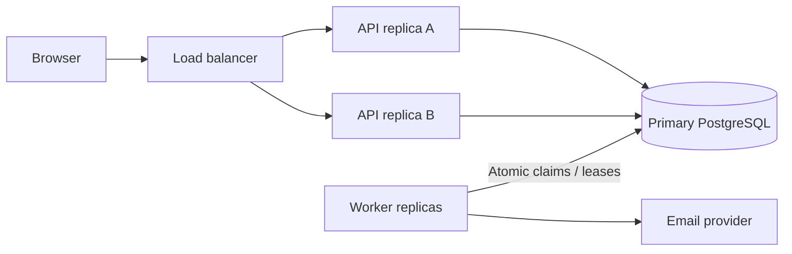

# Application improvements and system design experiments

Future learning plan, not implemented infrastructure. Keep the first release simple. A million registered users, a million daily visits, and a million simultaneous requests are different requirements.

## Define load before scaling

Illustrative assumptions, not a forecast: 1,000,000 visits/day is about 11.6 visits/second on average. At a 10x peak that is 116 visits/second. At 2% enquiry conversion, that is 20,000 submissions/day, or 0.23/second average and 2.3/second at the same peak factor. A visit can produce multiple requests; static cache hits and API writes must be measured separately.

Collect peak requests/second, concurrency, payload sizes, write/read mix, database size, p95 latency, errors, notification age and monthly cost. Set latency/availability targets from business needs, then load-test them. Do not claim capacity from user counts alone.

## Stages and acceptance criteria

| Stage | Proposed change when evidence warrants it | Verification |
|---|---|---|
| First users | One backend, managed PostgreSQL, static CDN | Reliable end-to-end flow; restore test |
| Growing traffic | Measure slow queries, tune indexes and pool, paginate admin reads | Compare query plans and p95 before/after |
| More concurrent API load | Stateless replicas behind load balancer | Kill replica; valid requests continue, retries do not duplicate enquiries |
| Notification backlog | Separate outbox worker deployment; bounded concurrency | Queue age remains within agreed target; outage drains after recovery |
| Expensive public reads | Cache selected catalogue content | Demonstrate hit rate, bounded staleness and invalidation |
| Database read pressure | Consider read replicas for suitable reads | Document replication lag; receipt/read-after-write stays on primary |
| Operational need for broker | Add queue only for clear throughput/fan-out needs | Duplicate delivery, poison messages and backpressure tested |

## Synchronous versus asynchronous

Synchronous: validate and commit enquiry before acknowledging it. Asynchronous: notifications, analytics and future document ingestion. Moving code to a background thread alone is not durable; pending work must survive a process crash.

The database commit and remote email call cannot be one ordinary ACID transaction. The outbox bridges that boundary with at-least-once processing. Claim tasks in short transactions; do not hold row locks open throughout slow network calls. Add timeouts, leases and retry limits.

## Caching

- Cache public assets/pages at CDN first. Never cache enquiry POST responses globally.
- Public service information can tolerate a documented short stale interval; customer contact data must not enter shared public caches.
- Redis is optional, not a default requirement. Introduce it for a measured need such as shared rate limiting or repeated expensive reads.
- Define cache keys, TTL, invalidation, stampede control and behaviour during cache outage.

## Distributed systems interview topics and exercises

- [ ] Race two identical submissions; explain why a pre-check alone fails.
- [ ] Crash a worker after send but before acknowledgement; explain duplicate delivery.
- [ ] Run two workers; prove tasks are claimed safely and expired claims recover.
- [ ] Explain total database connections: replicas multiplied by pool size, plus workers and operational headroom.
- [ ] Simulate provider latency; demonstrate timeouts, bounded retries, jitter and backpressure.
- [ ] Explain stale reads and why replica reads are unsuitable for immediate receipt verification.
- [ ] Demonstrate aggregate rate limiting across replicas; per-process limits are insufficient globally.
- [ ] Separate logs, metrics and traces; propagate correlation IDs without logging customer messages.
- [ ] Test backup recovery and specify recovery point/time objectives with the owner.
- [ ] Compare vertical scaling, replicas and partitioning using measurements; defer sharding until justified.

Production readiness requires measured results. Keep experiments isolated from real customers, with synthetic data and an explicit cost ceiling.
