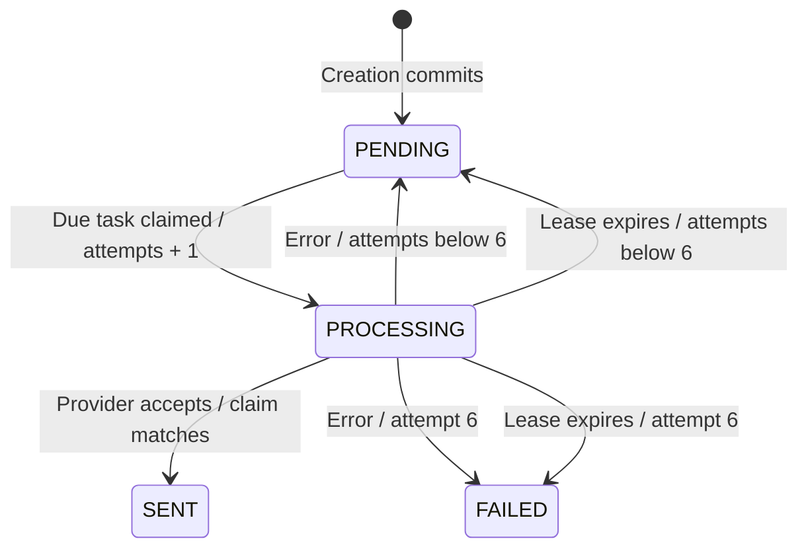

# Enquiry email notification specification

Status: proposed implementation specification. Runtime behaviour has not been verified by this document.
Date: 5 November 2026.

## 1. Purpose, in simple words

When a customer submits an enquiry, save both the enquiry and a reminder to email the mechanic. Return the customer's reference after both records commit. A background worker then sends the email.

The reminder is called an **outbox task**. It survives application restarts because it lives in PostgreSQL, not just Java memory. This approach is the transactional outbox pattern.

## 2. Scope and decisions

- One EMAIL task per enquiry, delivered to the configured mechanic inbox.
- Six total automatic delivery attempts: the initial attempt plus at most five retries.
- Email failure never deletes an enquiry that has already committed.
- Failure to insert the outbox task rolls back the enquiry insert too.
- No customer email receipt, WhatsApp, attachments or administration screen in this slice.
- Failed tasks remain available for investigation. A manual retry interface is future work; it must be controlled and auditable.
- SENT means the provider accepted the message, not that it reached the inbox or was read.

## 3. Flow and transaction boundaries

```mermaid
sequenceDiagram
    participant C as Customer
    participant A as Enquiry service
    participant T as Transactional creation operation
    participant D as PostgreSQL
    participant W as Background worker
    participant E as Email provider
    C->>A: Submit enquiry with submission key
    A->>T: Create if not already present
    T->>D: BEGIN; insert enquiry; insert PENDING task
    alt Both inserts succeed
        T->>D: COMMIT
        T-->>A: Saved enquiry
        A-->>C: Reference / successful receipt
    else Either insert fails
        T->>D: ROLLBACK
        T-->>A: Failure
        A-->>C: Error, or recover an identical concurrent submission
    end
    W->>D: Claim due task in short transaction
    D-->>W: Task and claim token
    W->>E: Send outside database transaction
    E-->>W: Accepted or delivery error
    W->>D: Record outcome if claim token still matches
```

There are separate short database transactions for creation, claiming, and recording the result. The external email call is not part of a PostgreSQL transaction. Never hold a database row lock while waiting for the provider.

## 4. Data contract

Migration: `V2__create_notification_outbox.sql`, provided that V2 is not already allocated. Never edit an applied migration.

| Field | Meaning |
|---|---|
| id UUID PK | Task identity; generated by application |
| enquiry_id UUID NOT NULL FK | Existing enquiry to notify about |
| channel VARCHAR(20) | EMAIL initially |
| status VARCHAR(20) | PENDING, PROCESSING, SENT or FAILED |
| attempt_count INTEGER | Starts at zero; incremented atomically when an attempt is claimed |
| next_attempt_at TIMESTAMPTZ | Earliest next eligible attempt |
| locked_until TIMESTAMPTZ, nullable | Lease expiry for a claimed attempt |
| claim_token UUID, nullable | New random token for each claim; prevents an old worker updating a newer claim |
| last_error VARCHAR(1000), nullable | Sanitised error category/description; no credentials or customer message |
| created_at TIMESTAMPTZ | Task creation time |
| sent_at TIMESTAMPTZ, nullable | Provider acceptance time |

Constraints: unique `(enquiry_id, channel)`, allowed channel/status values, nonnegative attempt count. Index due tasks by `(status, next_attempt_at)`; consider a separate PROCESSING lease-expiry index after measuring recovery queries. No cascading deletion by default: retention must explicitly handle linked records.

**Addition to the earlier SQL example:** include `claim_token UUID`. If V2 is already applied, add it through a new migration. A lease alone cannot prevent an expired worker from overwriting a newer worker's result.

## 5. Creation requirements

- **NOT-C01:** Initial accepted submission creates exactly one enquiry and one PENDING task with attempt_count zero in one transaction.
- **NOT-C02:** Failure of either insert leaves neither newly created row committed. Never return a successful receipt for that failed creation.
- **NOT-C03:** An identical submission retry returns the existing receipt and does not create a second task or reset its attempts.
- **NOT-C04:** Reusing the key with different normalised enquiry data returns 409 without changing either record.
- **NOT-C05:** Concurrent identical submissions converge on one enquiry and one task through database uniqueness and recovery outside the failed transaction.

Implementation direction: keep duplicate-key recovery in the outer service, and move enquiry-plus-outbox creation into a separate Spring bean's public transactional method (or use TransactionTemplate). Calling an annotated private/same-object method does not create the intended proxy boundary. Recover after transaction completion, not inside an aborted transaction.

## 6. Worker and retry requirements



- **NOT-W01:** Scheduler polls committed due PENDING tasks in bounded batches. Proposed starting settings: poll every 5 seconds, batch size 10, six attempts. These are configurable defaults, not measured capacity guarantees.
- **NOT-W02:** Claim atomically using row locking with SKIP LOCKED or equivalent conditional updates. Set PROCESSING, increment attempts, assign token and lease. Multiple worker instances must not claim the same live task.
- **NOT-W03:** Expired PROCESSING tasks are recovered. An attempt consumed before a crash still counts; after the sixth abandoned attempt mark FAILED rather than retry forever.
- **NOT-W04:** Use a finite provider timeout shorter than the lease. Proposed initial timeout 15 seconds and lease 60 seconds; check actual client timeout semantics before rollout. Claim only work that can start promptly, or renew leases for bounded concurrency.
- **NOT-W05:** On success, conditionally update by task ID, PROCESSING status and claim token; set SENT/sent_at and clear lease/token/error. A stale worker must not overwrite a later claim.
- **NOT-W06:** On a send error, conditionally record a sanitised error. If attempts remain, set PENDING and schedule retry; otherwise set FAILED. Clear lease and token when leaving PROCESSING.
- **NOT-W07:** Proposed delays after failed attempts 1–5: 30 seconds, 1 minute, 2 minutes, 4 minutes and 8 minutes. Add bounded jitter in production. No tight loop, sleeps inside database transactions, or unbounded retries.
- **NOT-W08:** Retry state survives application restarts. Use persisted timestamps and an injectable Clock for testable timing; keep worker/database clocks synchronised.
- **NOT-W09:** FAILED tasks stop automatic processing. Surface failure count and oldest pending age without logging customer details. A future manual retry must record who requested it and deliberately reset its retry budget.

## 7. Delivery guarantee and limits

A crash can occur after the provider accepts email but before SENT is saved. A timeout can also hide successful acceptance. Retrying may send a duplicate. This design uses at-least-once attempts, not exactly-once email delivery and not guaranteed eventual success.

Where supported, send the stable task ID as a provider idempotency key and verify the provider's retention window. Claim tokens prevent stale database updates; they cannot undo an email already sent. After six failed attempts, keep the enquiry and task for investigation.

## 8. Email content and configuration

- Recipient and sender come from server configuration; visitors cannot select arbitrary recipients.
- Subject: new garage enquiry plus generated reference. Treat visitor content as untrusted; use plain text initially and avoid injecting it into headers.
- Include reference and only the contact/vehicle/message details necessary for garage follow-up. No secrets or internal stack traces.
- Configure provider credentials outside Git. Use a local/sandbox inbox for development; tests must not email real customers or the mechanic.
- Production provider and email-domain verification remain open decisions. An EmailSender interface isolates that choice.

## 9. Test-first acceptance plan

### Gate A — Atomic creation, before real email

1. Valid submission commits one enquiry and one PENDING task linked by FK.
2. Force a real outbox insertion constraint failure in a disposable PostgreSQL test database; verify the enquiry insert rolls back. A mocked repository test alone cannot prove this.
3. Replay identical submission; verify same reference and unchanged task count/status/attempts.
4. Reuse key with changed message; verify conflict and unchanged original rows.
5. Race identical submissions using independent transactions; verify one enquiry and one task.
6. Verify FK, uniqueness and defaults against PostgreSQL and Flyway on an empty disposable database.

### Gate B — Worker with fake email sender

1. Due PENDING task is claimed and accepted delivery becomes SENT with timestamp.
2. Failed delivery schedules the expected next attempt; future-dated tasks are not sent early.
3. Sixth failure becomes FAILED; repeated polls perform no seventh automatic attempt.
4. Two workers cannot process the same unexpired claim.
5. Expired lease recovers; old token cannot update the recovered task.
6. Restart preserves retry schedule and attempts; expired sixth claim becomes FAILED.
7. Simulate accepted email followed by outcome-write failure; document duplicate risk and test stable provider key reuse where supported.

Use real PostgreSQL for transaction/locking tests and a fake clock/sender for deterministic retry tests. Avoid waiting minutes in tests. Run the existing enquiry tests as regression checks.

### Gate C — Sandbox integration

Verify one email reaches a local/sandbox inbox, provider failure leaves the enquiry saved, retries are visible, credentials/content are absent from logs, and HTTP receipt does not wait for email. No public rollout until these checks pass.

## 10. Coding order and completion evidence

1. Write PostgreSQL atomicity tests and observe the missing behaviour.
2. Add migration, notification model/repository, and transactional creation operation.
3. Make Gate A pass; preserve existing enquiry contract or explicitly update its spec.
4. Write worker state/retry tests, then implement claims and EmailSender boundary.
5. Make Gate B pass, then wire sandbox delivery and pass Gate C.
6. Update roadmap with commands, outcomes and remaining limitations. Do not mark delivery complete from source presence alone.

Related: [system design](system-design.md), [main spec](spec.md), [roadmap](acceptance%20criteria/roadmap.md).
