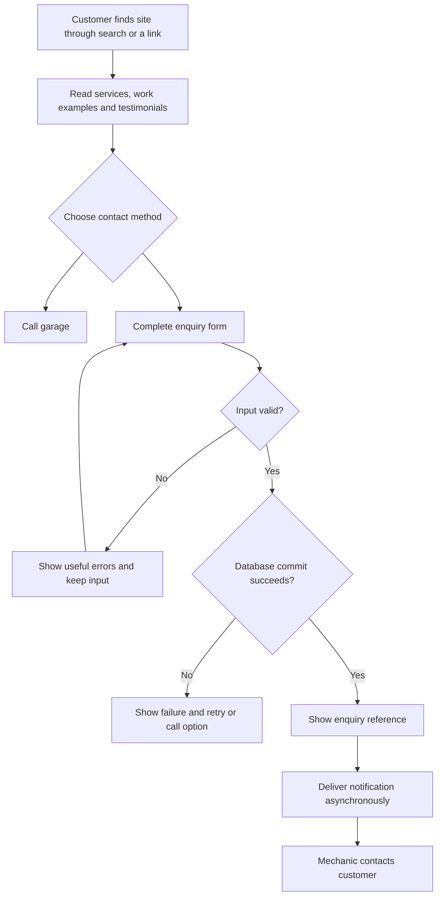

# Garage website specification

Status: proposed baseline for discussion, not a claim that features are implemented.
Last updated: 3 November 2026.

## 1. What is a specification?

A specification (spec) describes what we intend to build and the behaviour it must have. It is the shared agreement that guides implementation and testing.

Example: “A customer choosing phone contact must provide a phone number.” That is a requirement. “Enforce it in the service and database” is a design decision. “Submit without a phone number and verify rejection with no new row” is an acceptance check.

| File | Question answered |
|---|---|
| This specification | What are we building, for whom, and what must happen? |
| [System design](system-design.md) | How do components and data interact? |
| [Acceptance criteria](acceptance%20criteria/roadmap.md) | In what order do we build, and how do we prove it works? |
| Scaling and AI plans | What might we add later, and why? |

Read sections 2–5 first to understand the product. Use the requirement IDs below when discussing changes or naming tests.

## 2. Problem and purpose

A local independent mechanic needs a public website that explains services, demonstrates real workshop experience, and helps nearby customers contact the garage. The business specialises in BMW and also works on other makes. Buying and selling vehicles initially requires an enquiry flow rather than a full inventory marketplace.

The core outcome is a reliably recorded enquiry that the mechanic can act on. Local search visibility supports that outcome, but no particular search ranking is guaranteed.

## 3. Users and boundaries

| Actor | Needs | Boundary |
|---|---|---|
| Visitor | Find services, hours, location and contact options | No access to other visitors' data |
| Mechanic | Receive and follow up genuine enquiries | Private access required for future enquiry management |
| Maintainer | Deploy, diagnose failures and maintain approved content | Secrets and customer information stay protected |

Initial release excludes customer accounts, payments, confirmed online bookings, automated binding quotes, full vehicle inventory management and AI chat. A later AI phase is planned separately.

## 4. Customer journey



The receipt confirms storage of an enquiry. It does not confirm an appointment, a price or that the mechanic has read it. Notification failure does not undo a committed enquiry.

## 5. Functional requirements

### Public content

- **WEB-01:** Visitors can view garage identity, address/service area, opening hours and telephone number.
- **WEB-02:** Pages explain actual services, BMW specialism and other makes supported, without implying unsupported manufacturer affiliation.
- **WEB-03:** Work examples, photographs and testimonials are genuine and approved for publication.
- **WEB-04:** Buying/selling enquiries can be distinguished from servicing and repair enquiries.
- **WEB-05:** Public pages provide useful pre-rendered content, descriptive metadata and navigation suitable for mobile and search indexing.

### Enquiry submission

- **ENQ-01:** Accept name, preferred contact, enquiry type and message. Collect email/phone and optional vehicle make, model, year and registration.
- **ENQ-02:** Require nonblank name and message, a valid preferred contact value and a usable value for that selected method. Validate supplied email and agreed field lengths. Vehicle year rules remain to be agreed before implementation.
- **ENQ-03:** Supported types are SERVICE, REPAIR, BUY, SELL and OTHER. New enquiries start at NEW; the visitor cannot choose their operational status.
- **ENQ-04:** The backend assigns identity, reference and timestamps and records the version of the privacy notice actually displayed. Do not use a draft notice for public collection.
- **ENQ-05:** Return a receipt only after the database transaction commits. Do not expose the full stored entity or customer details in that receipt.
- **ENQ-06:** Repeating the same submission key with the same normalised payload returns the original receipt without a duplicate. Reusing it with different payload returns a conflict. Concurrent submissions obey the same rule.
- **ENQ-07:** Failed submissions show a clear error and preserve form input where possible. Invalid input creates no enquiry.
- **ENQ-08:** Do not expose public enquiry listing or customer-detail lookup endpoints.

### Notifications and private follow-up

- **NOT-01:** Before email-enabled public launch, create a pending notification atomically with the enquiry.
- **NOT-02:** Deliver email outside the customer's request with bounded retries and visible final failure. Preserve enquiries during provider outages.
- **NOT-03:** Delivery is at least once; duplicate notification risk and provider idempotency support must be documented.
- **ADM-01:** Later private management requires authenticated, authorised access, pagination and permitted status transitions.

## 6. API behaviour

Proposed entry point: `POST /api/v1/enquiries`, JSON body and `Idempotency-Key` header. The controller maps the header into an internal command; it is not a second independently editable body field.

| Scenario | Expected response / effect |
|---|---|
| First valid submission | 201, reference and receipt status; one committed enquiry |
| Identical retry | 200, original receipt; no duplicate |
| Key reused with different payload | 409; original enquiry unchanged |
| Invalid fields or malformed JSON | 400 with safe error details; no enquiry |
| Payload too large | 413 |
| Rate limit reached | 429 |
| Database unavailable | Appropriate failure, generally 503; no false receipt |

Illustrative response:

```json
{
  "reference": "ENQ-example",
  "status": "RECEIVED",
  "message": "Your enquiry has been received."
}
```

RECEIVED is an API acknowledgement; NEW is the stored operational status. Final error-body format and payload normalisation rules must be specified with the endpoint implementation and tested consistently.

## 7. Quality and operational requirements

- **OPS-01:** Migration scripts manage schema changes; applied migrations remain unchanged and JPA validates mappings.
- **OPS-02:** Secrets stay out of Git, logs and frontend assets. PostgreSQL is not directly accessible to website visitors.
- **OPS-03:** Public deployment uses HTTPS, bounded request sizes, timeouts, abuse controls and minimal health information. CORS is not authentication or spam prevention.
- **OPS-04:** Test against PostgreSQL for database-specific behaviour; include invalid input, concurrent retries, transaction rollback and notification failure.
- **OPS-05:** Use separate environment configuration and verify database backup restoration and deployment rollback before public launch.
- **OPS-06:** Agree retention/deletion and privacy information before collecting real customer details. Avoid logging contact information or message contents.
- **OPS-07:** Agree measurable availability, latency, recovery and cost targets before claiming production capacity. A million users is not a defined requests-per-second target.
- **UX-01:** Form labels, validation errors, keyboard access, loading feedback and mobile layout work end to end.

## 8. Delivery stages and traceability

| Stage | Outcome | Requirements / verification |
|---|---|---|
| Foundation | Migration and entity mapping | OPS-01; roadmap slice 1 |
| Persistence | Repository and transactional service | ENQ-02–05; slice 2 |
| REST flow | Validated, idempotent public contract | ENQ-01–08; slice 3 |
| Notifications | Durable follow-up notification | NOT-01–03; slice 4 |
| Frontend | Visitor submits and receives a truthful receipt | WEB-01–05, UX-01; slice 5 |
| Private workflow | Mechanic manages enquiries securely | ADM-01; slice 6 |
| Launch | Deployment, privacy, recovery and SEO checks | OPS-01–07; slice 7 |
| Later learning | Scale experiments and bounded AI chatbot | Separate plans; slice 8 |

The first useful local milestone is a valid REST submission persisted in PostgreSQL and verified through a test and DBeaver. It does not require a frontend, email provider or AI model.

## 9. Future AI scope

Later chatbot uses approved garage content, with RAG only if retrieval is useful. It must enforce backend spending/rate limits, avoid fabricated prices and diagnoses, and hand off unsupported questions. Any enquiry tool requires visitor confirmation and reuses the existing service. See [AI plan](ai%20agentic%20flow/chatbot-rag.md).

## 10. Unresolved owner decisions

Garage name and town; actual services and pricing policy; contact details and opening hours; approved content; privacy/retention policy; hosting/domain budget; notification recipient/provider; frontend choice; operating targets; AI scope and budget.

These do not block a local prototype. Relevant decisions must be resolved before the affected public feature launches.

## 11. How we change this spec

When a requirement changes, record what changed and why, update its ID and linked acceptance checks, then update implementation/tests. A spec is a maintained agreement, not an automatically enforced configuration file. It does not generate or deploy the application.
