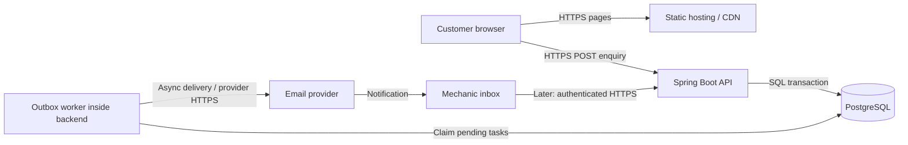
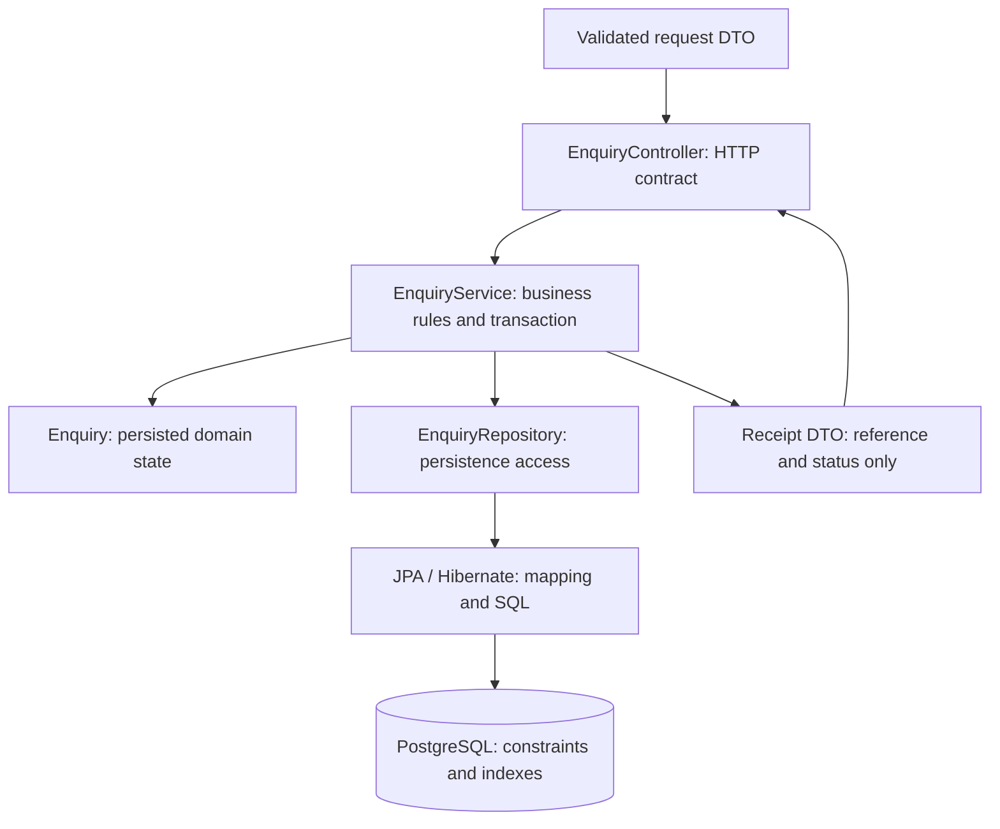
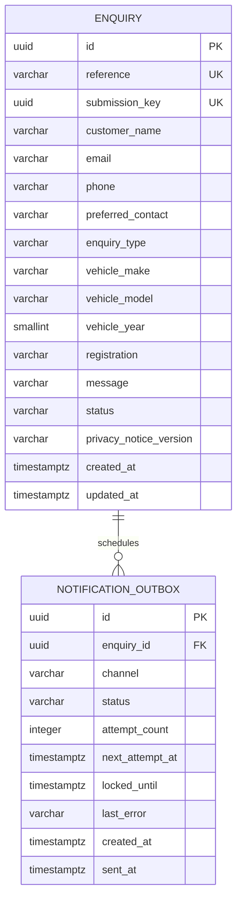
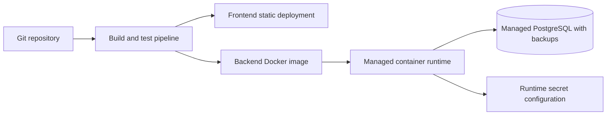

# System design

## Goal and scope

A public website for one independent mechanic specialising in BMW and servicing other makes. Visitors explore services, workshop work and testimonials, then call or submit an enquiry. Buying/selling vehicles initially means enquiries, not a stock management platform. A submission is neither an appointment nor a confirmed quote.

Backend decisions: Java 21, Spring Boot, Gradle and PostgreSQL. Proposed frontend: pre-rendered Next.js/React pages. Start with one modular backend and managed infrastructure. Authentication, notifications and AI are later slices.

## High-level design: proposed launch target



The website continues serving informational pages if the backend is unavailable. Form submission must then display a failure and offer the garage phone number. PostgreSQL is private; neither browser nor frontend assets contain database or AI credentials.

## Low-level design: proposed layers



Suggested packages beneath `com.garage.garage_api.enquiry`: `model` (existing), `dto`, `repository`, `service`, `controller`. Keep dependencies directed toward business behaviour; do not expose JPA entities as API requests or responses. One concrete service is sufficient; avoid interfaces with no alternative implementation.

## Enquiry flow: target behaviour

```mermaid
sequenceDiagram
    participant B as Browser
    participant C as Controller
    participant S as Service
    participant D as PostgreSQL
    participant W as Worker
    B->>C: POST /api/v1/enquiries + Idempotency-Key
    C->>C: Validate fields and request size
    C->>S: Validated command
    S->>D: Begin transaction; create enquiry and outbox task
    D-->>S: Commit
    S-->>C: Receipt
    C-->>B: 201 Created for first submission
    W->>D: Claim committed pending task
    W->>W: Send notification with retry/backoff
    W->>D: Record delivery outcome
```

Early slice: save enquiry only. Add the outbox before claiming reliable email delivery. HTTP waits for persistence, not email delivery. JPA may issue SQL during flush; success must mean the transaction committed.

Idempotency: same key and same normalised payload returns the original receipt; same key with different payload returns 409. A database unique constraint settles concurrent races. A lookup-before-insert alone is insufficient. On a unique-conflict race, recover outside the failed transaction and compare the existing record. Do not catch a PostgreSQL constraint failure and continue using the aborted transaction.

## Data model



Only ENQUIRY currently exists in migration source. Outbox is planned with unique `(enquiry_id, channel)` and due-work index `(status, next_attempt_at)`.

The current `(status, created_at)` enquiry index supports `WHERE status = 'NEW' ORDER BY created_at DESC LIMIT 20`. It does not optimise every query and adds write/storage cost. Primary-key and unique constraints already provide indexes. A customer table is deferred: contact details submitted by a visitor are not verified identity.

`NEW -> CONTACTED -> CLOSED` is the proposed operational flow; spam may be marked separately. Define allowed transitions in the service before implementing admin updates. JPA callbacks maintain timestamps for entity writes, not direct SQL or bulk updates.

## HTTP contract: target

| Operation | Outcome |
|---|---|
| POST `/api/v1/enquiries` | 201 on initial durable creation; receipt without customer details |
| Retry matching submission | 200 with original receipt |
| Invalid input / malformed JSON | 400 with safe field errors |
| Reused key, changed payload | 409 |
| Request too large / rate limited | 413 / 429 |
| Persistence unavailable | 503 when appropriate; never a false receipt |
| GET `/actuator/health` | Minimal health; no credentials or internals |

Later admin endpoints require authentication and authorisation. No public enquiry listing or customer-detail lookup. Public references are identifiers, not authentication secrets.

## Deployment: proposed



Local: application on host connects to Docker-published PostgreSQL port. In deployment, `localhost` means the application container itself; use the database service hostname. Use separate development, staging and production credentials. Run Flyway migrations in a controlled deployment step; keep backward compatibility for rolling releases. Test restore procedures, not just backup creation.

## Interview discussion

Explain the requirement before the technology: durable enquiries are the core value. Synchronous database commit gives a truthful receipt; asynchronous notification isolates provider failures. A monolith minimises operational work. Database constraints protect against races. Static pages handle most visits cheaply. Introduce replicas, queues and caches only after measurements identify a bottleneck. Availability and consistency trade-offs depend on the operation: stale service text may be acceptable, lost enquiries are not.

SEO is a separate ongoing business effort: accurate local content, Google Business Profile, real reviews, crawlable pages and indexing checks. No technical design guarantees a top-ten ranking.
